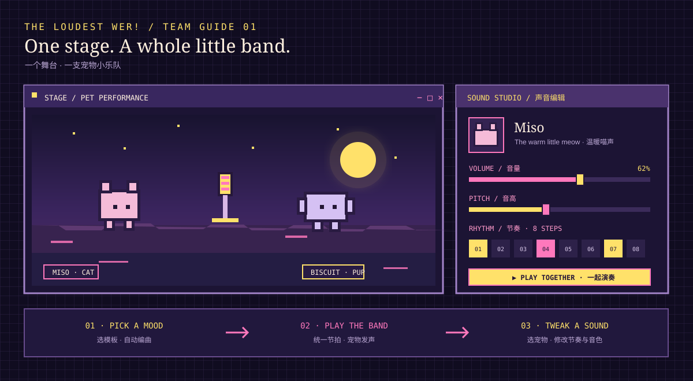
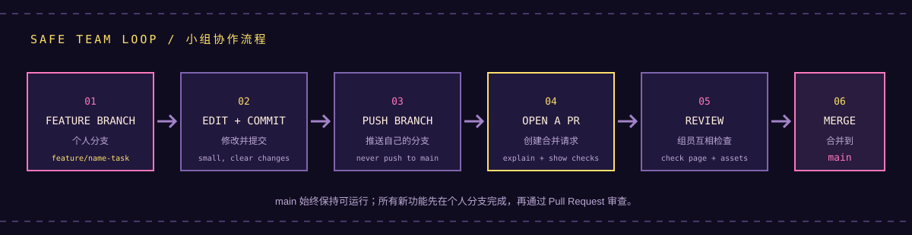
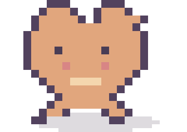
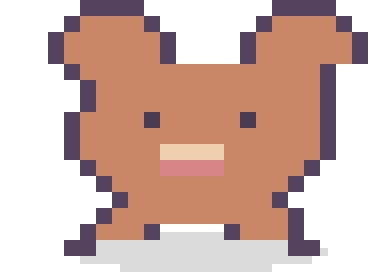
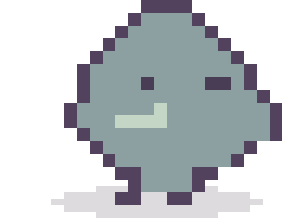

# The Loudest WER! · Team Starter Guide

小组协作与素材替换说明 · English first, 中文辅助



## 1. Get the project running / 运行项目

The project has no package install step. It uses plain HTML, CSS, JavaScript, and the browser's Web Audio API.

1. Download the ZIP from GitHub, or clone the repository.
2. Open Terminal in the project folder and run:

   ```sh
   python3 -m http.server 8000
   ```

3. Visit `http://localhost:8000/` in a browser. Keep Terminal open while the page is in use.
4. Click **Play together** once to allow the browser to start audio.

本项目无需安装依赖。下载 ZIP 或 Clone 后，在项目文件夹启动本地网页服务器，再访问上面的地址。声音需要先点击一次播放按钮。

## 2. Work together on GitHub / 用 GitHub 协作



Before working, check whether you have **Write** access and confirm the target branch with the team. A teammate without Write access should ask a repository administrator for access or Fork the repository and open a Pull Request.

### For a team member with Write access / 有写入权限的团队成员

```sh
git clone https://github.com/sd5913/The-Loudest-WER-.git
cd The-Loudest-WER-
git switch -c feature/name-short-task
```

Make one focused change, preview it locally, then:

```sh
git status
git add path/to/changed-file
git commit -m "Describe the change"
git push -u origin feature/name-short-task
```

On GitHub, choose **Compare & pull request**. Set the base branch to the one agreed by the team, describe what changed and how it was checked, then ask a teammate to review. Merge only after review. Do not push unfinished work directly to a protected or shared base branch.

### If a teammate does not have Write access / 没有写入权限

On GitHub, click **Fork**, clone their fork, and use the same feature-branch steps. When opening the Pull Request, set the base repository and base branch to the team's agreed destination.

### Safe everyday rhythm / 每次修改的小流程

1. Fetch and pull the agreed base branch before starting a new task.
2. Work on your own feature branch; do not edit another person's branch at the same time.
3. Preview the page and test the interaction you changed.
4. Check `git status` and review the diff before committing.
5. Open a Pull Request with a short summary and the steps you checked. For a concise bilingual workflow and asset map, see [Team Guide / 团队协作与素材替换说明](团队协作与素材替换说明.md).

## 3. Replace art and sound / 替换图片与声音

### Pet sprites / 宠物图

  

Replace a sprite by putting a transparent PNG in `assets/pets/` with the matching name. Keep the canvas close to **384 × 272 px** (96:68 ratio). The six names are `cat.png`, `dog.png`, `bird.png`, `bunny.png`, `frog.png`, and `fox.png`.

### Stage background / 舞台背景

Put a full-scene PNG named `seaside-park.png` in `assets/backgrounds/`. Recommended size: **640 × 340 px**. Refresh the page to see it. When the file is absent, the built-in pixel scene is drawn automatically.

### Home room backgrounds / 首页房间背景

The Home page uses two full-page desktop PNG wallpapers in `assets/backgrounds/`: `home-night.png` and `home-sunset.png`. Keep the original **1672 × 941 px** ratio so the clickable pets and mood cord stay aligned. The three room cats are Mystery Cat, Orange Cat, and White Cat. Each theme has transparent sprites aligned over the cats already painted into its wallpaper: the sunset versions are `mystery-cat-guitar.png`, `orange-cat-christmas.png`, and `white-cat-christmas.png`; the night versions end in `-night.png`. Clicking a cat slightly enlarges it in place and plays its voice; there is no popup portrait. Use the Home top bar’s Arrange / 调整位置 button to drag the three cats; positions save per theme in the current browser, and Reset / 恢复默认 restores the current theme defaults. The top navigation stays visible while scrolling. The wallpaper's painted monitor has no separate computer overlay; Start Playing / 开始一起演奏 opens Music Studio. The paired Home logo and three illustrated action buttons are in `assets/wer-christmas-ui/` as `logo_night.png`, `logo_sunset.png`, and the original `button_{start,create,adopt}_{night,sunset}.png` files. The page displays matching `*_uniform.png` versions with a shared 300 × 100 canvas and display at 70% size (210 × 70); replace those versions too to keep the three buttons aligned. Hover over or focus the pull cord to see its glow; click it to switch themes. Use the top navigation to open My Pets, Music Studio, and My Collection. On narrow screens, the art moves into a page section so it remains fully visible.

### Sounds / 声音

`assets/sounds/` contains original synthesized WAV examples. Do not replace them with recordings unless the team has permission and the license is documented. Sound selection and rhythm behavior live in `app.js`.

On **My Pets**, upload or record a short voice and save it with a custom pet. On **Music Studio**, **Import your pet voice / 上传宠物声音** offers a temporary voice preview. Both routes apply browser-side electronic filtering and pitch control; nothing is sent to a server. Custom pets and saved voices stay in this browser's local storage. Studio-only imports clear when the page reloads.

## 4. Where to edit / 代码修改位置

| File or folder | Change it when… |
| --- | --- |
| `index.html`, `home.js` | Editing the interactive pet home, cord-based theme switch, and time-of-day mood. |
| `pets.html`, `pets.js` | Editing photo/voice entry, pet collection, and adoption. |
| `studio.html`, `app.js` | Editing the music studio, pets, audio, templates, rhythm, and stage drawing. |
| `collection.html`, `collection.js` | Editing locally saved music sessions. |
| `store.js`, `theme.js` | Editing browser-local data and shared Sunset/Night behavior. |
| `gallery.js` | Editing the gallery cards, preview sounds, or invite links. |
| `style.css`, `gallery.css`, `experience.css` | Adjusting layout, responsive behavior, and the shared four-page system. |
| `pixel-ui.css` | Changing shared pixel components and the dark purple / neon palette. |
| `assets/pets/` | Replacing pet PNG artwork. |
| `assets/backgrounds/` | Replacing the stage background PNG. |
| `assets/sounds/` | Replacing approved sound samples. |

When several people edit the same file, split the work into small Pull Requests and review conflicts before merging. Never put passwords, private photos, API keys, or unlicensed audio in the repository.

## 5. What this prototype includes / 初版内容

The site includes an interactive home with automatic local-time modes and a pull-cord Sunset/Night switch; a My Pets page with browser-local pixel photo previews, voice recording/upload, and a Pumpkin Band adoption shelf; a Music Studio with scene selection, three starter cats, sound controls, templates, random arrangement, shared-tempo Play/Pause, and pet feedback; and a My Collection page that reopens browser-local sessions. Photo processing is a pixelated preview, not AI cutout or background removal. Saves do not sync between devices; there is no cloud publishing or music export yet.

当前初版有互动式宠物之家、黄昏/夜晚氛围和拉绳切换；宠物页可创建像素预览并录制/上传声音，也可领养南瓜乐队；工作室可换场景、编辑声音与节奏并保存作品；收藏页可再次打开本机保存的合奏。照片处理是像素化预览，不是 AI 抠图；数据保存在当前浏览器，不会同步到其他设备。
